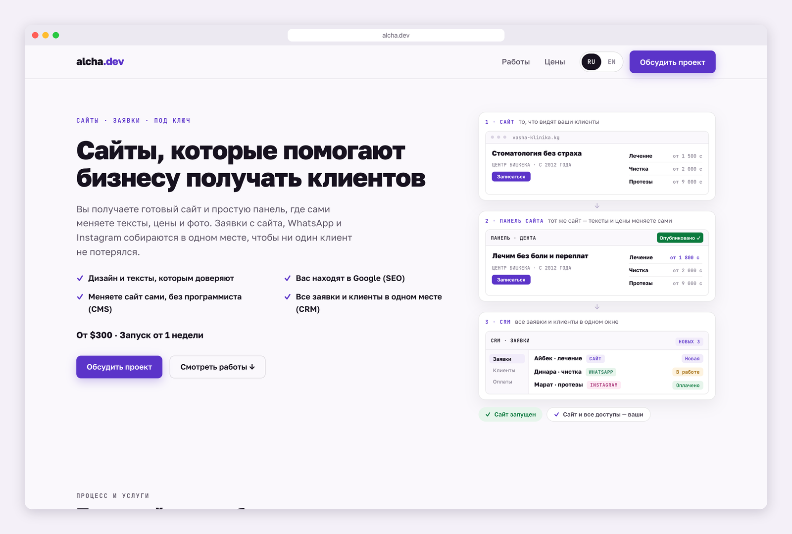
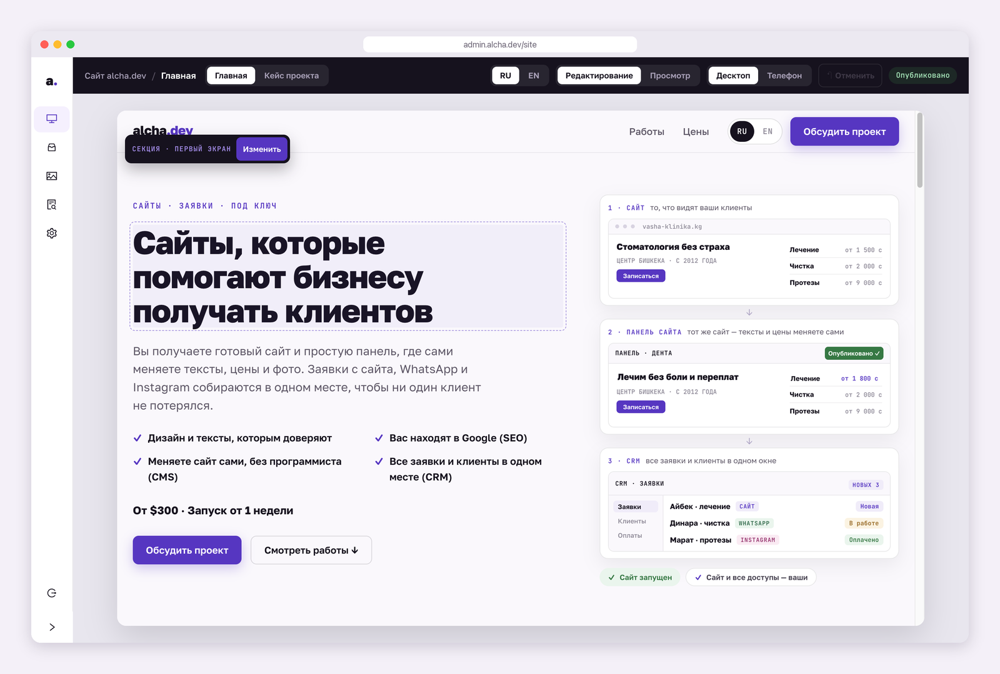
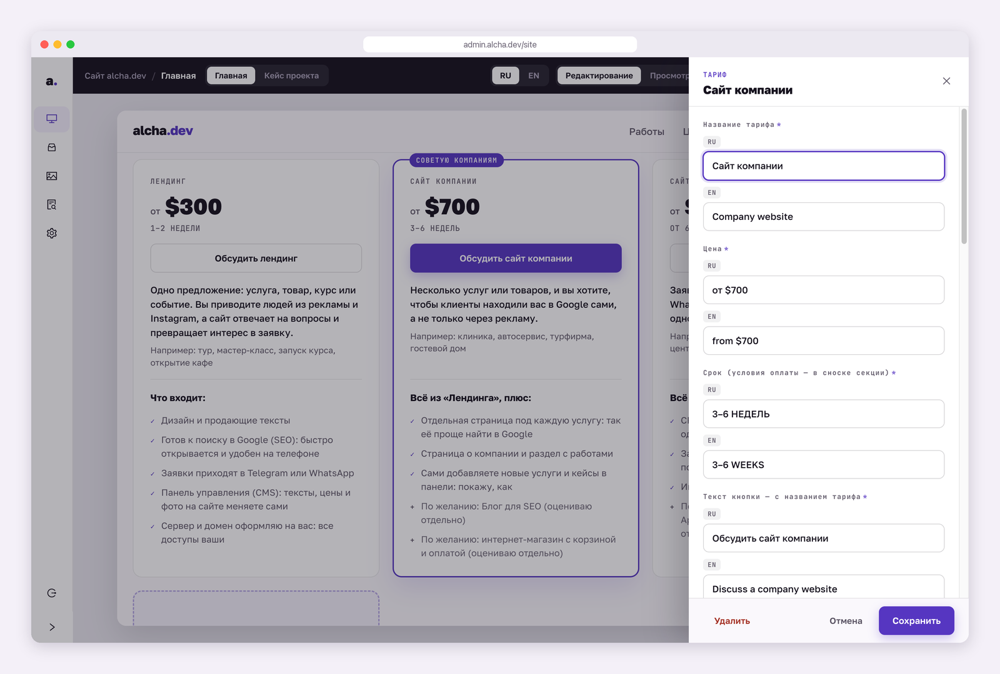
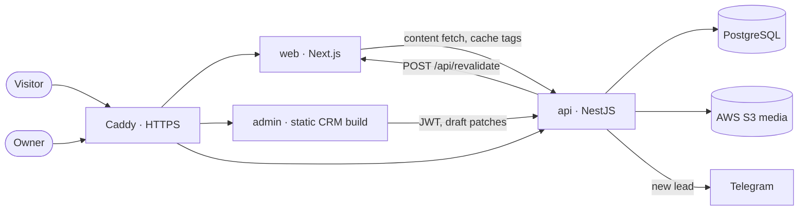

<p align="center">
  <a href="https://alcha.dev"></a>
</p>

<h1 align="center">alcha.dev</h1>

<p align="center">
  Website, admin panel and API of <b>Alcha Dev</b>, an IT company in Bishkek, Kyrgyzstan,<br>
  that builds websites, CRM systems and mobile apps for businesses.
</p>

<p align="center">
  <a href="https://alcha.dev"><b>alcha.dev</b></a> ·
  <a href="https://alcha.dev/en">English version</a> ·
  <a href="https://admin.alcha.dev">Admin panel</a> (login required) ·
  <a href="https://api.alcha.dev/health">API status</a>
</p>

One pnpm + Turborepo monorepo holds the three products:

| Product                     | URL                                           | Stack                                          |
| --------------------------- | --------------------------------------------- | ---------------------------------------------- |
| [Website](#website)         | [alcha.dev](https://alcha.dev)                | Next.js 15 (App Router), SSG + ISR, next-intl  |
| [Admin panel](#admin-panel) | [admin.alcha.dev](https://admin.alcha.dev)    | React 19, Vite 6, Ant Design 5, TanStack Query |
| [API](#api)                 | [api.alcha.dev](https://api.alcha.dev/health) | NestJS 11, Prisma 6, PostgreSQL 16, AWS S3     |

They share one TypeScript contract in [`packages/shared`](packages/shared): zod DTOs, a typed API client, and the content tree that the visual editor patches.

---

## Website

**[alcha.dev](https://alcha.dev)** is the public site: services, a process section, case studies, pricing and a contact form.

- Russian lives at the root and English under [`/en`](https://alcha.dev/en). Every page has hreflang, a canonical URL and a sitemap entry.
- Every page is prerendered (SSG). After a publish in the admin panel it is refreshed on demand with `revalidateTag`, so content updates go live in seconds without a rebuild.
- Structured data includes `WebSite`, `ProfessionalService` (with an offer catalog), `Person`, `BreadcrumbList` and `CreativeWork`. The site also has an icon set, a web manifest and Open Graph images rendered by `/api/og`.
- The case pages (`/works/[slug]`) render one of two layouts, chosen from the data: a detailed one (see [alcha.dev's own case](https://alcha.dev/works/alcha-dev)) or a compact one (see [Chaban](https://alcha.dev/works/chaban) and [Kit Store](https://alcha.dev/works/kit-store)).




## Admin panel

**[admin.alcha.dev](https://admin.alcha.dev)** is where the site is run. Its main page, **«Сайт»**, edits the real website rather than a form:

- The site renders in an iframe in draft-preview mode. Clicking a text edits it in place, and a section's «Изменить» opens a drawer with the rest of its fields: lists, images and per-locale copy.
- Every change is a patch on a draft tree, with undo history and a change counter. «Опубликовать» validates the draft, writes it to the database and revalidates the pages that changed.
- The other pages are **Заявки** (leads from the contact form, also sent to Telegram), **Медиа** (uploads converted to WebP and stored on S3), **SEO** (titles, descriptions, Open Graph images) and **Настройки** (contacts, phone, socials, analytics).





The editor's architecture, data-attribute contract and postMessage protocol are documented in [docs/visual-editor.md](docs/visual-editor.md).

## API

**[api.alcha.dev](https://api.alcha.dev/health)** is a JSON API with no UI in production. Swagger runs only in development, at `http://localhost:4000/docs`.

- **Public content** is served at `/content/home`, `/content/chrome`, `/content/settings` and `/projects/:slug`, each with a `locale` parameter. The website caches each response under a tag (`content:home`, `project:<slug>`, …).
- **The content tree** is served at `/admin/content/tree`, edited through `/admin/content/draft` and published through `/admin/content/publish`. Draft reads for the preview iframe use a short-lived preview token that never works as an admin token.
- **Auth** uses a JWT access token plus an httpOnly refresh cookie, which is why the admin panel lives on a subdomain of the site.
- **Leads** are rate-limited, stored in Postgres and sent to Telegram.
- **Media:** the API only signs presigned S3 URLs. The admin panel converts images to WebP in the browser and uploads them straight to the bucket.

```bash
curl "https://api.alcha.dev/content/home?locale=en"
```

---

## How the pieces fit



**Content pipeline:** the owner edits in the admin panel, which patches a single draft (both locales) through the API. Publishing validates the draft, writes the content tables in one transaction, then calls `POST /api/revalidate` on the website. Next.js refreshes the tagged pages, and the next visitor gets the new static HTML. As a safety net, every page also revalidates hourly.

## Repository layout

```
apps/
  web/     Next.js 15 public website (SSG + ISR)                      :3000
  crm/     React 19 + Vite admin panel with the visual editor         :5173
  api/     NestJS 11 + Prisma REST API                                :4000
packages/
  shared/  zod DTOs, typed API client, CMS tree/patch/bridge contract
deploy/
  Caddyfile                 reverse proxy + automatic HTTPS
docs/
  visual-editor.md          editor architecture and decisions
  seo-plan.md               SEO strategy and keyword research
  screenshots/              images used in this README
docker-compose.yml          local Postgres (+ optional MinIO for S3)
docker-compose.prod.yml     production stack: postgres, api, web, crm, caddy
deploy.sh                   production deploy (pull, build, migrate, restart, verify)
seed-once.sh · backup.sh · configure-s3.sh
```

## Local development

**Prerequisites:**

- Node 22 (`nvm use`; Node 20.9+ also works).
- pnpm 9 (`corepack enable`).
- Docker, for Postgres.

```bash
pnpm i
cp .env.example .env          # dev defaults work as-is
pnpm db:up                    # Postgres in Docker (pnpm db:up:all adds MinIO)
pnpm db:migrate               # apply Prisma migrations
pnpm db:seed                  # RU + EN content and the admin user
pnpm dev                      # web :3000 · admin :5173 · api :4000
```

Once it's running:

- **Website:** http://localhost:3000 (English at http://localhost:3000/en).
- **Admin panel:** http://localhost:5173. Log in with `SEED_ADMIN_EMAIL` / `SEED_ADMIN_PASSWORD` from `.env`.
- **API docs:** http://localhost:4000/docs.

**Root scripts:**

| Script                                                | What it does                                                           |
| ----------------------------------------------------- | ---------------------------------------------------------------------- |
| `pnpm dev`                                            | Starts Postgres, then all three apps in parallel (Turborepo)           |
| `pnpm build`                                          | Builds shared → api → web → crm                                        |
| `pnpm lint` / `pnpm typecheck`                        | ESLint and `tsc --noEmit` across the workspace                         |
| `pnpm test`                                           | API unit tests (including the CMS contract spec) and the web SEO tests |
| `pnpm db:migrate` / `pnpm db:seed` / `pnpm db:studio` | Prisma migrations, seed, Prisma Studio                                 |

**Seeding wipes content.** `pnpm db:seed` deletes all content and any unpublished draft before loading the seed.

**Environment.** Every variable is documented in [.env.example](.env.example). The main groups are:

- database: `DATABASE_URL`;
- auth: `JWT_*`;
- revalidation: `REVALIDATE_SECRET`, shared by the API and the website;
- cross-service URLs: `WEB_URL`, `API_URL`, `CRM_URL`;
- media: `S3_*`;
- lead notifications: `TELEGRAM_*`;
- analytics and search-console verification: `NEXT_PUBLIC_*`, all optional.

CI ([.github/workflows/ci.yml](.github/workflows/ci.yml)) runs lint, typecheck, build, unit tests and the API e2e suite against a real Postgres.

## Production

The whole stack runs on one Hetzner Cloud server (Helsinki) with Docker Compose:

- **Caddy** is the only public container. It serves `alcha.dev`, `api.alcha.dev` and `admin.alcha.dev` with automatic HTTPS, and redirects `www` to the apex domain.
- **Postgres** is reachable only on the internal network, and is dumped daily by [backup.sh](backup.sh).
- **Media** is stored on AWS S3 (eu-north-1).

Deploys run on the server with [deploy.sh](deploy.sh). The order is deliberate: Postgres → migrations → API healthy → then build the website. `next build` prerenders against the live API, and a build without it would ship blank pages. The script finishes by revalidating the cache and checking every public URL.

## SEO

The site is built to rank for website, CRM and app development in Bishkek. [docs/seo-plan.md](docs/seo-plan.md) holds:

- the keyword research, from Google Autocomplete localized to Kyrgyzstan;
- the planned page structure (service pages, pricing, about and contacts);
- the roadmap.

## Author

Built by **Dastan Rakhmanzhanov**, founder of Alcha Dev and a Senior Frontend Engineer: [LinkedIn](https://www.linkedin.com/in/dastan-rakhmanzhanov) · [GitHub](https://github.com/dastan0017) · [Telegram](https://t.me/rakhmanzhanov). Project requests go through [alcha.dev](https://alcha.dev).
